# 02 · Architecture — Kubernetes

One workflow run, from issue to pull request. The POC runs on Azure (AKS); the design is cloud-agnostic, so supporting services are named generically — [Runs on any cloud](#runs-on-any-cloud) maps them.

## High-level architecture

| Namespace | Holds | Trust |
|---|---|---|
| `platform` | workflow service, artifact service | platform — trusted |
| `argo` | Argo Workflows | platform |
| `github-broker` | GitHub token broker | platform |
| `agents` | planner, coder, reviewer, open-PR step — one ServiceAccount per role | **untrusted**, model-driven |

### Workflow sequence

1. GitHub sends a webhook to the workflow service when an issue is ready.
2. The workflow service submits a run to Argo Workflows.
3. Argo runs each step as an agent pod.
4. The agent requests a scoped GitHub token from the broker.
5. The agent calls models through the AI gateway.
6. The agent pushes commits and comments on GitHub.
7. The agent updates status and stores artifacts through the platform services.

Steps 3–7 repeat for each agent in the loop. Decisions: [ADR-003](./decisions/003-platform-services-vs-agent-pods.md), [ADR-004](./decisions/004-orchestration-argo-workflows.md), [ADR-005](./decisions/005-state-and-artifacts.md).

### State

- **Workflow service** owns runs, retries, start times and per-task cost in PostgreSQL — the system of record.
- **Argo** holds minimal execution state, well under etcd's 1 MB object limit.
- **Artifact service** carries handoffs between steps — summaries, notes, logs, screenshots — backed by object storage. Create-only: each agent creates its own artifacts, none overwrites another's.
- Intermediate working state never lands in GitHub.

### Model per step

One goose process can't switch models mid-run, but every step is its own pod — so each step gets its own model via `GOOSE_MODEL` / `GOOSE_PROVIDER`, set by the workflow template ([ADR-006](./decisions/006-models-and-llm-access.md)).

## Short-lived credentials for cloud and GitHub

Kubernetes issues every workload a short-lived token tied to its ServiceAccount. Each side exchanges it differently:

- **Platform services** exchange it with the cloud's identity provider for access to cloud resources — on Azure, Microsoft Entra Workload ID.
- **Agent pods get no cloud identity.** The [token broker](./reference/token-broker.md) exchanges their token for a GitHub token scoped to the pod's role and one repository.

Same Kubernetes identity, two exchanges. Every token expires. Pods never name the repository — the broker looks it up — so a pod can't ask for access to another one.

When agents call the platform services — for status and artifacts — they use **HMAC tokens** scoped to their workflow run, design borrowed from [Tally Split](https://tallysplit.ai.julie.io/).

### GitHub access per agent role

Each role is limited to one repository.

| Role | Access |
|---|---|
| planner | read code, write issues |
| coder | write code |
| reviewer | read code, comment on pull requests |
| open-PR step | open pull requests |

Commits are made by the agent's own GitHub user account and GPG-signed; the broker's token only authenticates the push ([ADR-012](./decisions/012-agent-identity-commits-vs-github-tokens.md)). Deep dives: [identity](./reference/identity.md), [GitHub configuration](./reference/github-configuration.md).

## Runs on any cloud

The platform runs in one virtual network. Agent egress is controlled, and every supporting service is network-integrated with the cluster.

| Capability | Azure | AWS | Google Cloud |
|---|---|---|---|
| **Managed Kubernetes** — platform services, Argo, one pod per agent step | AKS | Amazon EKS | GKE |
| **Virtual network** — one boundary for cluster and services | VNet | VPC | VPC |
| **Network integration** — provider backbone, public or private endpoints | Service endpoints, Private Endpoints | Gateway endpoints, PrivateLink | Private Google Access, Private Service Connect |
| **Egress control** — where agents can send data | Azure Firewall | AWS Network Firewall | Cloud NGFW |
| **Workload identity** — platform services only; agent pods get none | Entra Workload ID | EKS Pod Identity | Workload Identity Federation for GKE |
| **Secrets** | Key Vault | Secrets Manager | Secret Manager |
| **Container registry** — agent images close to the nodes | ACR | Amazon ECR | Artifact Registry |
| **Platform database** — runs, retries, cost | Azure Database for PostgreSQL | Amazon RDS for PostgreSQL | Cloud SQL for PostgreSQL |
| **Object storage** — run artifacts, outside the cluster | Blob Storage | Amazon S3 | Cloud Storage |
| **Model access** — managed, network-integrated endpoint | API Management AI gateway | Amazon Bedrock | Vertex AI |

> [!NOTE]
> **Pod startup in seconds requires network integration.** It keeps traffic on the provider's backbone instead of crossing the public internet. Every step starts a new pod, and it should be ready in seconds, not minutes.

## Design decisions

The full reasoning lives in the [ADRs](./decisions/). In short — decided for the platform:

| Decision | ADR |
|---|---|
| Argo Workflows, one pod per agent step, no nesting | [004](./decisions/004-orchestration-argo-workflows.md) |
| Agent pods: no cloud identity; HMAC tokens to platform services; one `agents` namespace, ServiceAccount per role | [003](./decisions/003-platform-services-vs-agent-pods.md) |
| GitHub token broker instead of tokens in a cloud vault | [003](./decisions/003-platform-services-vs-agent-pods.md), [012](./decisions/012-agent-identity-commits-vs-github-tokens.md) |
| Workflow service is the system of record; webhook goes straight to it | [004](./decisions/004-orchestration-argo-workflows.md), [005](./decisions/005-state-and-artifacts.md) |
| One PostgreSQL server, separate databases; Argo via workload identity | [005](./decisions/005-state-and-artifacts.md) |

**Interim choices** — POC shortcuts, each with a production path:

| Choice | Production path | ADR |
|---|---|---|
| Vercel AI Gateway | the cloud provider's network-integrated model gateway | [006](./decisions/006-models-and-llm-access.md) |
| No egress firewall | route agent egress through a firewall, allow only GitHub, the model gateway and package registries | [002](./decisions/002-isolation-levels.md) |
| Skills baked into the image | left to the platform — reuse its existing distribution mechanism | [013](./decisions/013-skills-distribution.md) |

Next: [03 · Requirements](./03-requirements.md)
