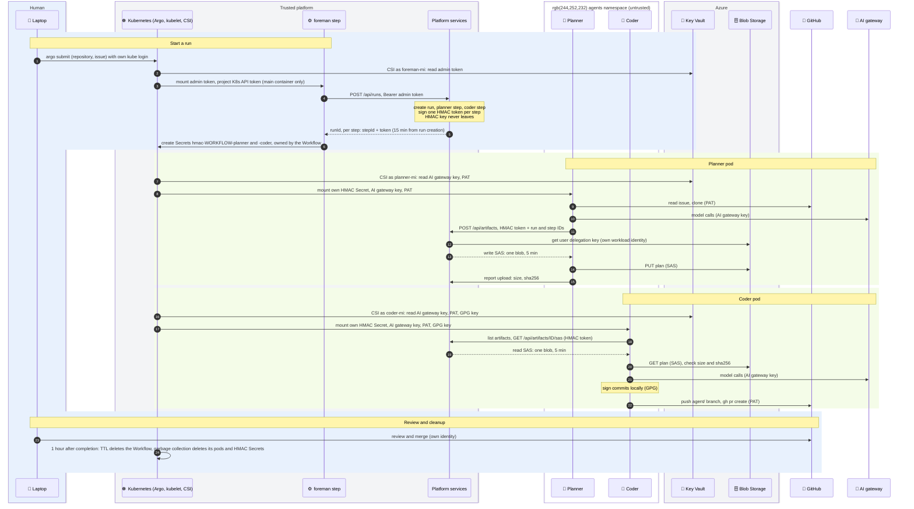

# Credential flow — one run, end to end

Who creates each credential, where it lives, and which pod may hold it, for one run of the initial release: `argo submit` → `foreman` → planner → coder → pull request. Built and run on AKS on 2026-11-11.

- **Agents get long-lived secrets only by mount.** Key Vault values arrive through the CSI driver under the pod's own workload identity, one secret-scoped grant each ([ADR-003](../decisions/003-platform-services-vs-agent-pods.md#workload-identity-for-long-lived-secrets)).
- **Only the trusted `foreman` step can create runs.** Agent pods never see the admin token. They get one HMAC step token each, delivered as a Kubernetes Secret ([ADR-016](../decisions/016-hmac-caller-authentication.md)).
- **Artifact bytes go directly to Blob Storage** with short-lived, one-blob SAS URLs. Platform services signs them with a user delegation key and never holds a storage account key ([ADR-015](../decisions/015-sas-signing-and-local-identity.md)).
- **Credentials reach the `main` container only.** Argo's helper containers (`init`, `wait`) get neither the workload identity token nor the mounted secrets.

## Sequence

Platform services' own access, not shown above: it reads the admin token and the HMAC key through CSI (`platform-services-secrets`), and exchanges its workload identity for Entra tokens to PostgreSQL and Blob Storage.

## Credentials

| Credential | Created by | Stored in | Held by | Scope | Lifetime |
|---|---|---|---|---|---|
| Admin token | Human | Key Vault, mounted by CSI | Platform services; `foreman` | Create runs | Static |
| HMAC signing key | Human | Key Vault, mounted by CSI | Platform services only | Signs every step token | Static |
| HMAC step token | Platform services | Kubernetes Secret per step, written by `foreman`, owned by the Workflow | One agent pod | One run, one step, its role's actions | 15 minutes from run creation |
| Upload / download SAS | Platform services | Nowhere: response only | One agent pod | One blob, write or read | 5 minutes |
| AI gateway key | Human | Key Vault, mounted by CSI | Planner, coder | Model calls | Static |
| GitHub PAT (temporary) | Human, for `@julieio-goose` | Key Vault, mounted by CSI | Planner, coder | Repository access of `@julieio-goose` | PAT expiry |
| GPG private key | Human | Key Vault, mounted by CSI | Coder only | Signs commits as `@julieio-goose` | Key expiry |
| Workload identity token | Kubernetes, projected | Pod | Planner, coder, `foreman`, platform services | Exchanged for its own managed identity's grants only | Auto-rotated |
| `foreman` Kubernetes API token | Kubernetes, projected | `foreman` main container | `foreman` | `secrets: create` in `agents` | 10 minutes |
| Argo executor token | Human, once | Kubernetes Secret | Argo's `init` and `wait` containers | Report step results | Static |
| Human Azure and kube login | Human | Laptop | Human | Cluster admin | Session |

## Isolation inside a pod

- **Workload identity token:** the pod annotation `azure.workload.identity/skip-containers: init;wait` keeps it out of Argo's helper containers.
- **Mounted secrets:** Argo copies every `main` volume mount into its `wait` container under `/mainctrfs`. A `podSpecPatch` in each template deletes the credential copies.
- **Kubernetes API:** agent pods get no API token. `automountServiceAccountToken` is off; only `foreman` gets a projected token, and only in `main`.
- **Between roles:** each pod mounts only its own HMAC Secret and its own CSI class. The planner can't read the GPG key or the coder's token.

## Accepted trade-offs

- **The model can read every credential in its pod**: the HMAC step token, the PAT and the AI gateway key. Recipes tell it never to print them; that is guidance, not enforcement. Hiding the HMAC token alone would protect little, since the PAT is far stronger.
- **The PAT is not role-scoped.** The planner could push too. Rulesets still require a PR and signed commits on `main`.
- **SAS URLs and model output reach the step logs.** Logs stay in the cluster and disappear with the Workflow TTL.

## Target design

| Initial release | Target |
|---|---|
| Temporary PAT in Key Vault | Per-pod GitHub App token from the [token broker](./token-broker.md), downscoped to the role and one repository |
| HMAC step tokens, delivered by `foreman` | Kubernetes ServiceAccount authentication ([ADR-016](../decisions/016-hmac-caller-authentication.md)) |
| `argo submit` by the human | GitHub webhook to the workflow service |
| One GPG key for `@julieio-goose` | One key per role ([ADR-014](../decisions/014-commit-signing.md)) |
